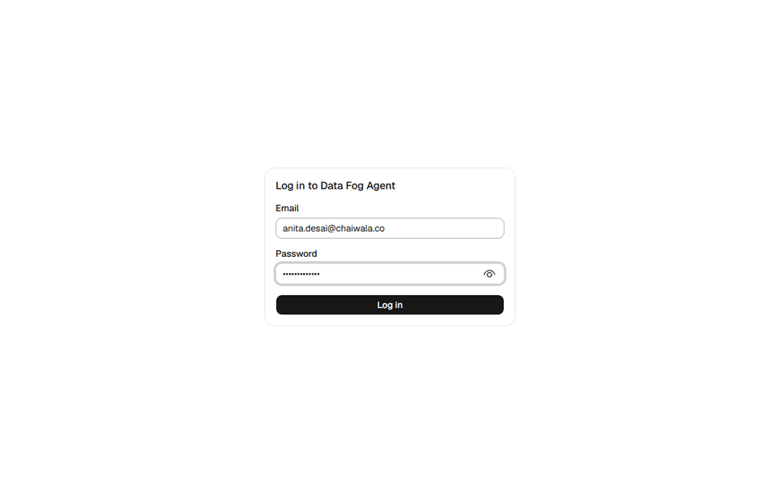
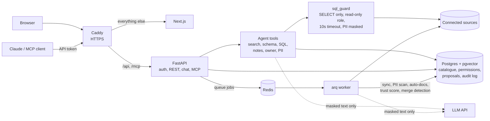

# Data Fog Agent

An agentic system that **finds, explains, cleans and protects** a company's scattered data.

Companies keep data in databases, file drives and chat. Nobody knows what exists, which copy is
right, who owns it, or where the personal data is. Data Fog Agent connects to those sources,
builds one catalogue, and puts an agent on top of it.



| Module | What it does |
|---|---|
| **Fog Eraser** | Syncs Postgres databases, a file drive and a Slack export into one catalogue. A chat agent answers questions and runs safe, read-only SQL. |
| **PII Guard** | Finds Aadhaar, PAN, phone, email, names and addresses (regex rules + Presidio), tags the columns, and masks the values everywhere. |
| **Auto-Docs** | Drafts descriptions for undocumented tables, columns and files. Owners approve them. |
| **Trust Score + Alerts** | Scores every asset (freshness, owner, docs, usage, not a stale copy) and alerts on stale data, schema changes and new personal data. |
| **File Merger** | Finds copies of the same file, shows what a merge would do, and merges only after a person approves. Undo puts everything back. |
| **MCP Server** | Gives Claude and other MCP clients the same tools, with the same permissions. |

Two rules run through all of it: **the agent proposes, people approve**, and **nothing is ever
deleted, only archived**.

## Architecture



- **Slow work runs in the worker**, never inside an API request: syncing, scanning, drafting
  docs, scoring, merging.
- **One set of permission checks.** The web UI, the chat agent and the MCP server all go through
  `visible_asset_ids(user)` and the same tool functions. Postgres row-level security keeps
  organisations apart underneath that.
- **The model never sees credentials or unmasked personal data.** Questions, tool results, doc
  prompts and embeddings are masked before they leave the server.
- **Everything is audited**: every query, tool call, MCP call, approval and merge step.

## Run it locally

You need Docker. The demo company, "Chaiwala Co.", comes with the repo.

```bash
cp .env.example .env          # then fill in JWT_SECRET and CONFIG_ENCRYPTION_KEY (commands are in the file)
docker compose up --build

# first admin (asks for a password)
docker compose exec backend uv run python -m app.create_admin --org "Chaiwala Co." --email admin@chaiwala.co --name Admin

# the demo company: three messy databases, a file drive, a Slack export, users and groups
docker compose exec backend uv run python /demo/generate.py
```

Open http://localhost:3000, log in as the admin, and click **Sync now** on each source on the
Sources page. Demo members (see [users.md](users.md)) log in with `chaiwala-demo`.

Chat needs `LLM_API_KEY` (any OpenAI-compatible API with tool calling; NVIDIA by default).
Search by meaning needs `EMBEDDING_API_KEY` (Gemini by default); without it search matches
keywords only.

## Connect Claude (MCP)

Make a token on the **Settings** page, then:

```bash
claude mcp add --transport http data-fog http://localhost:3000/mcp --header "Authorization: Bearer <token>"
```

Tools: `search_catalog`, `get_schema`, `run_sql`, `search_knowledge`, `find_owner`,
`list_pii_columns` and `propose_merge` (which only creates a proposal for the Approvals page).
A token sees what its user sees, and every call is in the audit log with actor `mcp`.

## Tests and evals

```bash
docker compose exec backend uv run pytest                      # backend tests, against a real Postgres
docker compose exec backend uv run ruff check .                # lint
docker compose exec backend uv run python /evals/run_evals.py  # evals against the demo company
```

The evals check three things against `demo/ground_truth.yaml`: that every personal-data column
is tagged, that every group of copied files is proposed for merging, and that the agent answers
the questions in `evals/questions.yaml` (finding the right table, numbers, business rules,
permissions, and refusing to delete data or reveal personal data). CI runs all of it.

## Deploy

One Linux server, Docker Compose, Caddy for HTTPS. See [docs/deploy.md](docs/deploy.md).

## Layout

```
backend/app/        FastAPI app: agent, sql_guard, connectors, pii, docs_gen, trust, merger, mcp_server, worker
backend/tests/      pytest suite
frontend/           Next.js + shadcn/ui
demo/               generate.py builds the demo company and ground_truth.yaml
evals/              questions.yaml + run_evals.py
infra/              Caddyfile and Postgres init scripts
docs/               deploy guide and user guide
```

Build notes per phase are in [PROGRESS.md](PROGRESS.md).
